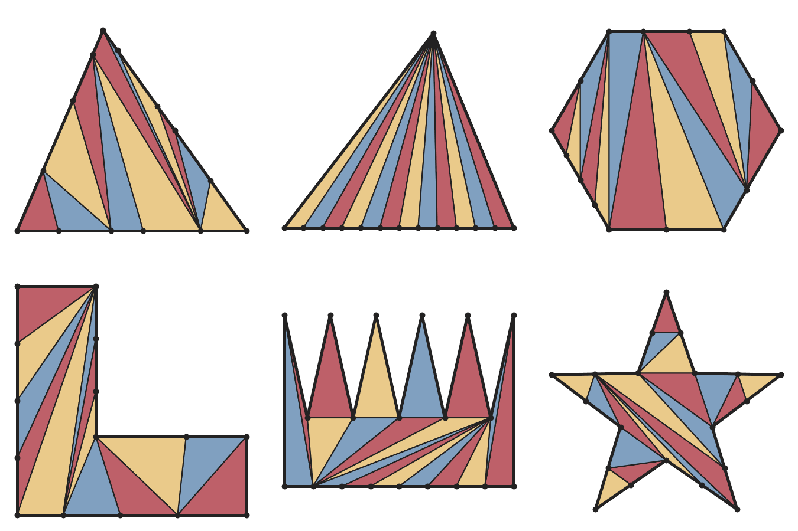

# vangogh

Triangulation of simple polygons by ear clipping, robust to collinear vertices. Given a simple polygon, convex or
not, whose boundary may contain arbitrarily many collinear vertices (such as a mesh triangle subdivided along its
edges), it computes a triangulation that uses every vertex and contains no degenerate (zero-area) triangles.



## Usage

```rust
use nalgebra::Vector2;

// A counter-clockwise polygon of (id, position): a triangle with two extra vertices on its bottom side.
let polygon = [
    (0, Vector2::new(0., 0.)),
    (1, Vector2::new(1., 0.)),
    (2, Vector2::new(2., 0.)),
    (3, Vector2::new(3., 0.)),
    (4, Vector2::new(0., 3.)),
];
let triangles = vangogh::triangulate(&polygon).unwrap(); // three triangles of ids, counter-clockwise
```

`triangulate` returns `None` if no such triangulation exists, e.g. when all vertices are collinear. A planar 3D polygon
can be triangulated in a projection onto its plane; the ids carry the triangles back.

## How it works

Ear clipping, which always succeeds by the two-ears theorem (G. H. Meisters, *[Polygons Have
Ears](https://doi.org/10.2307/2319703)*, American Mathematical Monthly 82(6), 1975). An ear is clipped only if no
other vertex lies in it and both the ear and the rest of the polygon keep a positive area. Among the valid ears, the
one that leaves the largest smaller area goes first, which avoids slivers. Orientation is decided exactly with
Shewchuk's adaptive precision predicates (*[Adaptive Precision Floating-Point Arithmetic and Fast Robust Geometric
Predicates](https://doi.org/10.1007/PL00009321)*, 1997), so rounding cannot leave a flat triangle.

## License

MIT
